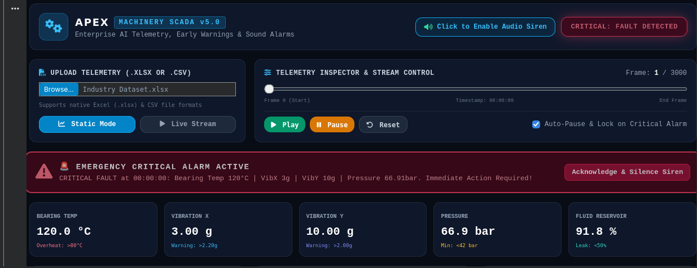
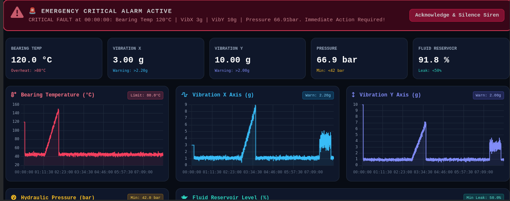
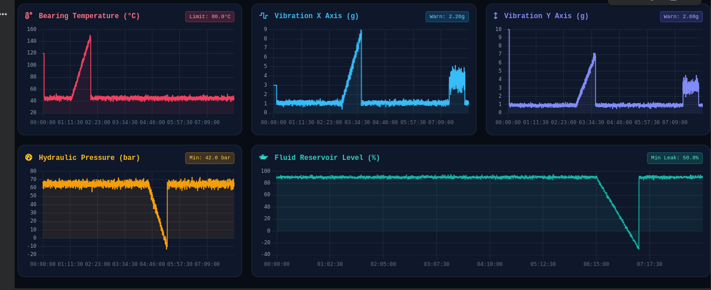

# 🏭 Machine Learning SCADA Dashboard & Real-Time Emergency Alarm System

An enterprise-grade **Industrial Predictive Maintenance System** and **Real-Time SCADA Control Dashboard** designed for heavy machinery telemetry monitoring, fault detection, and early emergency alarms.

This repository implements a full-stack architecture combining a **Random Forest Classification Model** trained on multi-channel industrial sensor streams with an interactive web dashboard featuring live trend plotting and an automated audio siren synthesizer.

---

## 📸 Screenshots

### 1. Dashboard Overview

> *Main SCADA control room interface displaying real-time telemetry inputs, file uploader, frame scrubber, and mode toggle controls.*

---

### 2. Critical Alarm Banner & Emergency Siren

> *Active emergency alarm state triggered automatically when sensor values breach danger limits, highlighting the exact timestamp and physical operator directive.*

---

### 3. Telemetry Graphs & Threshold Safety Limits

> *Dedicated trend graphs for Bearing Temperature, Vibration X/Y Axis, Hydraulic Pressure, and Fluid Reservoir Levels with explicit visual cut-offs.*

---

## ⚙️ Key Technical Features

* **🤖 Machine Learning Breakdown Prediction:**
  Classifies healthy machine states vs. 5 failure modes:
  * **Bearing Overheating** ($\text{Temp} > 80.0^\circ\text{C}$)
  * **Shaft Misalignment** ($\text{Vib}_X > 2.20\text{ g}$, $\text{Vib}_Y > 2.00\text{ g}$)
  * **Hydraulic Pressure Loss** ($\text{Pressure} < 42.0\text{ bar}$)
  * **Fluid Tank Leaks** ($\text{Level} < 50.0\%$)
  * **Excessive Motor Vibration** ($\text{Vib} > 3.00\text{ g}$)

* **📊 Dual Operational Monitoring Modes:**
  * **Static Dataset Overview:** Immediately plots all 3,000 dataset rows across all 5 charts for offline engineering diagnostics.
  * **Live Streaming Mode:** Simulates real-time 100ms telemetry frame streaming for control room operation.

* **🔊 Web Audio API Emergency Siren Synthesizer:**
  Features a built-in browser audio synthesizer that generates real-time warning sounds when thresholds are violated.

* **📁 Native Excel (.xlsx) & CSV Parser:**
  Supports direct client-side parsing of raw Excel spreadsheets (`.xlsx`) and CSV files without external server dependency.

---

## 🛠️ Tech Stack

* **Machine Learning / Data Science:** Python, Jupyter Notebook, Scikit-Learn, Pandas, NumPy, Joblib
* **Frontend SCADA UI:** HTML5, Tailwind CSS, JavaScript (ES6+), Chart.js
* **Data Parsing & Audio:** SheetJS (XLSX Parser), PapaParse, Web Audio API
